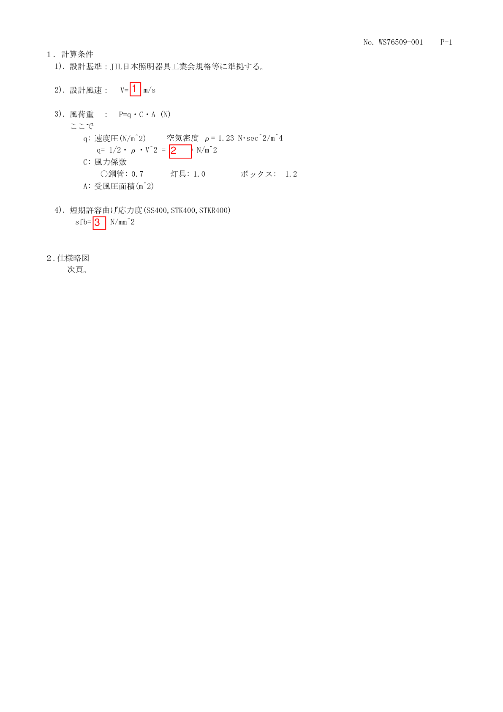
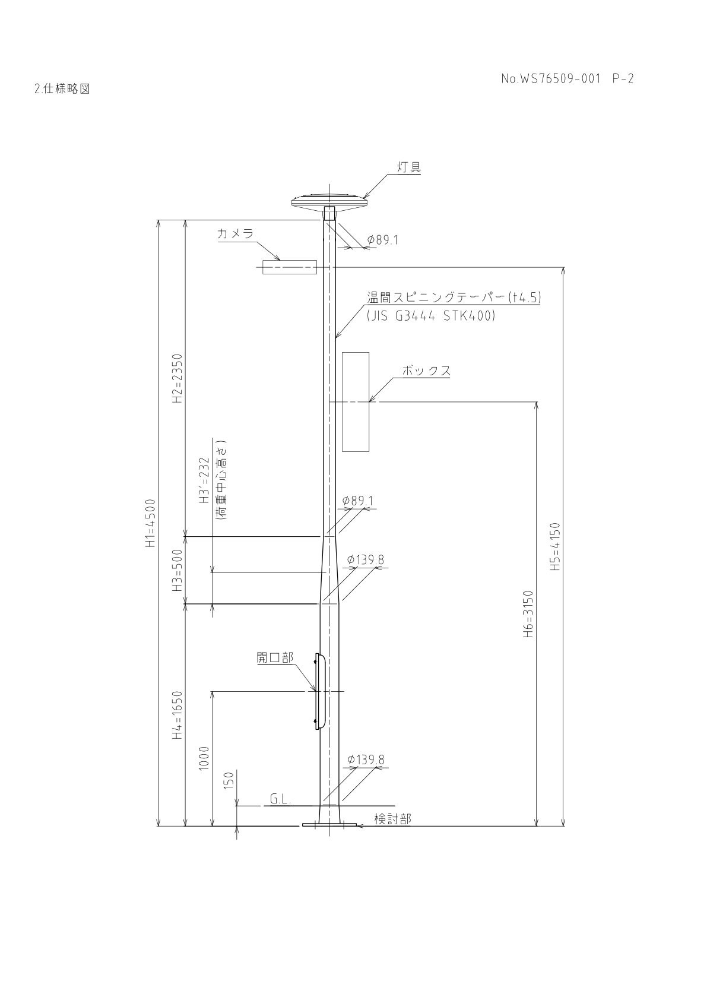
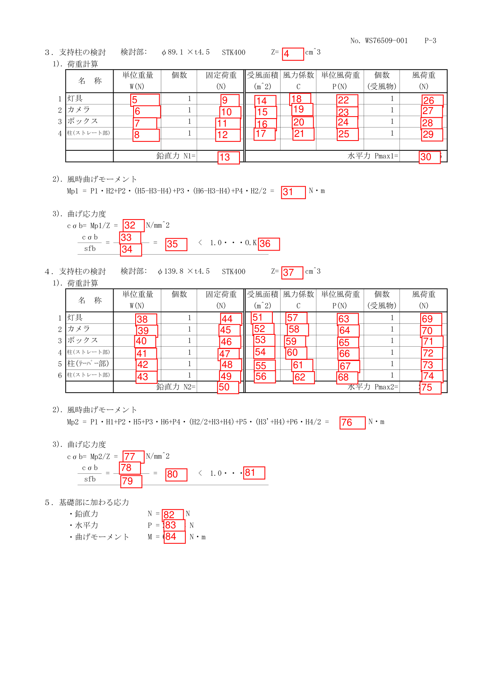

# Mapping Output Report 1-84 ke Calculation Engine

Dokumen ini memetakan output bernomor 1 sampai 84 pada report engineering ke
object, attribute, atau expression yang tersedia pada calculation engine Python
saat ini.

Dokumen ini mengikuti kondisi berikut:

- `e1` dan `e2` adalah dua `EvaluatedPosition` yang diperiksa.
- Calculation engine tetap menghitung delapan arah angin.
- Report omni menggunakan arah `N`, yaitu sudut 90 derajat dan gaya positif
  pada sumbu Y.
- Kontribusi Arm belum dimasukkan.
- Pole, Direct Object, dan Overhead Wire tetap dihitung oleh calculator
  masing-masing.
- Status strength adalah `O.K` jika utilization ratio `< 1.0`; nilai tepat
  `1.0` atau lebih menghasilkan `N.G`.

## Referensi report

### Design condition dan output nomor 1-3



### Skematik Pole dan lokasi EvaluatedPosition e1/e2



Pada calculation engine, `e1` dan `e2` adalah identifier untuk posisi yang
dievaluasi. Nilai elevasinya tetap disimpan secara eksplisit dalam meter pada
`evaluated_position_m`.

### Output report nomor 4-84



## 1. Alias object yang digunakan

Gunakan hasil calculation pada kedua titik evaluasi:

```python
e1_result = evaluated_position_calculator.calculate_at(E1_M)
e2_result = evaluated_position_calculator.calculate_at(E2_M)

e1_n = e1_result.report_result
e2_n = e2_result.report_result

e1_pole_aggregate = pole_calculator.aggregate_at(E1_M)
e2_pole_aggregate = pole_calculator.aggregate_at(E2_M)

e1_do_aggregate = direct_object_calculator.aggregate_at(E1_M)
e2_do_aggregate = direct_object_calculator.aggregate_at(E2_M)
```

`report_result` mengambil hasil arah `N` yang digunakan oleh report omni.

### Helper arah angin

```python
def get_direction(items, direction="N"):
    return next(
        item
        for item in items
        if item.direction == direction
    )
```

### Helper Direct Object

```python
def get_direct_object(aggregate, object_name):
    return next(
        item
        for item in aggregate.direct_object_results
        if item.object_name == object_name
    )
```

Contoh alias Direct Object:

```python
e1_luminaire = get_direct_object(e1_do_aggregate, "Luminaire")
e1_camera = get_direct_object(e1_do_aggregate, "Camera")
e1_box = get_direct_object(e1_do_aggregate, "Box")

e2_luminaire = get_direct_object(e2_do_aggregate, "Luminaire")
e2_camera = get_direct_object(e2_do_aggregate, "Camera")
e2_box = get_direct_object(e2_do_aggregate, "Box")

e1_luminaire_n = get_direction(e1_luminaire.directional_results)
e1_camera_n = get_direction(e1_camera.directional_results)
e1_box_n = get_direction(e1_box.directional_results)

e2_luminaire_n = get_direction(e2_luminaire.directional_results)
e2_camera_n = get_direction(e2_camera.directional_results)
e2_box_n = get_direction(e2_box.directional_results)
```

Nama `Luminaire`, `Camera`, dan `Box` harus sama dengan `name` yang diberikan
saat membuat `DirectObject`.

### Helper Pole

```python
def get_pole(aggregate, pole_name):
    return next(
        item
        for item in aggregate.pole_results
        if item.geometry.pole_name == pole_name
    )
```

Contoh alias Pole:

```python
e1_upper_pole = get_pole(
    e1_pole_aggregate,
    "Upper Straight Pole",
)

e2_upper_straight = get_pole(
    e2_pole_aggregate,
    "Upper Straight Pole",
)

e2_middle_tapered = get_pole(
    e2_pole_aggregate,
    "Middle Tapered Pole",
)

e2_lower_straight = get_pole(
    e2_pole_aggregate,
    "Lower Straight Pole",
)
```

Mengambil Pole berdasarkan nama lebih aman daripada mengandalkan posisi index.
Secara internal, `pole_results` disusun dari Pole bawah menuju Pole atas.

## 2. Design condition - nomor 1 sampai 3

| No. | Nilai report | Object atau expression saat ini | Satuan |
|---:|---|---|---|
| 1 | Design wind speed | `WIND_CONDITION.basic_wind_speed_m_s` | m/s |
| 2 | Wind pressure, `q` | `WIND_CONDITION.wind_pressure_at(top_elevation_m)` | N/m2 |
| 3 | Allowable bending stress | `e1_n.wind_strength.allowable_stress_n_mm2` | N/mm2 |

Untuk design standard 2 sampai 5, wind speed masih berupa konstanta di dalam
`WindCondition.wind_pressure_at()`:

```python
design_standard in (2, 3)  # 60 m/s
design_standard == 4       # 40 m/s
design_standard == 5       # 50 m/s
```

Akibatnya, nomor 1 belum mempunyai output property yang bersih untuk standard
2 sampai 5. `basic_wind_speed_m_s` dapat bernilai `None` pada standard tersebut.

## 3. Evaluated Position e1 - nomor 4 sampai 36

Hasil arah N untuk Pole pada e1 dapat diambil dengan:

```python
e1_upper_pole_n = get_direction(
    e1_upper_pole.directional_results
)
```

### Nomor 4 sampai 13

| No. | Nilai report | Object atau expression saat ini | Satuan |
|---:|---|---|---|
| 4 | Section modulus e1 | `e1_result.section_properties.section_modulus_cm3` | cm3 |
| 5 | Unit weight luminaire | `e1_luminaire.mass_per_unit_kg * 9.80665` | N |
| 6 | Unit weight camera | `e1_camera.mass_per_unit_kg * 9.80665` | N |
| 7 | Unit weight box | `e1_box.mass_per_unit_kg * 9.80665` | N |
| 8 | Unit weight upper Pole | `e1_upper_pole.mass_kg * 9.80665` | N |
| 9 | FixLoad luminaire | `e1_luminaire.fix_load_n` | N |
| 10 | FixLoad camera | `e1_camera.fix_load_n` | N |
| 11 | FixLoad box | `e1_box.fix_load_n` | N |
| 12 | FixLoad upper Pole | `e1_upper_pole.fix_load_n` | N |
| 13 | Total FixLoad, `N1` | `e1_result.total_fix_load_n` | N |

Nomor 8 adalah berat sebelum Overdesign Factor. Nomor 12 adalah FixLoad Pole
yang sudah mengandung Overdesign Factor.

### Nomor 14 sampai 21

| No. | Nilai report | Object atau expression saat ini | Satuan |
|---:|---|---|---|
| 14 | Area luminaire per unit | `e1_luminaire_n.projected_area_m2 / e1_luminaire.quantity` | m2 |
| 15 | Area camera per unit | `e1_camera_n.projected_area_m2 / e1_camera.quantity` | m2 |
| 16 | Area box per unit | `e1_box_n.projected_area_m2 / e1_box.quantity` | m2 |
| 17 | Area upper Pole | `e1_upper_pole.projected_area_m2` | m2 |
| 18 | Wind coefficient luminaire | `e1_luminaire.cf` | - |
| 19 | Wind coefficient camera | `e1_camera.cf` | - |
| 20 | Wind coefficient box | `e1_box.cf` | - |
| 21 | Wind coefficient upper Pole | `e1_upper_pole.cf` | - |

`DirectObjectDirectionalResult.projected_area_m2` sudah mengandung pengalian
quantity. Karena kolom report menampilkan area per unit, nilainya dibagi
`quantity`.

### Nomor 22 sampai 30

| No. | Nilai report | Object atau expression saat ini | Satuan |
|---:|---|---|---|
| 22 | Unit wind load luminaire | `e1_luminaire_n.wind_load_n / e1_luminaire.quantity` | N |
| 23 | Unit wind load camera | `e1_camera_n.wind_load_n / e1_camera.quantity` | N |
| 24 | Unit wind load box | `e1_box_n.wind_load_n / e1_box.quantity` | N |
| 25 | Unit wind load upper Pole | `e1_upper_pole.wind_load_n` | N |
| 26 | Total wind load luminaire | `e1_luminaire_n.wind_load_n` | N |
| 27 | Total wind load camera | `e1_camera_n.wind_load_n` | N |
| 28 | Total wind load box | `e1_box_n.wind_load_n` | N |
| 29 | Total wind load upper Pole | `e1_upper_pole.wind_load_n` | N |
| 30 | Total horizontal wind load, `Pmax1` | `e1_n.total_wind_load_n` | N |

Quantity Pole saat ini dibatasi satu. Karena itu, nomor 25 dan 29 membaca nilai
yang sama.

### Nomor 31 sampai 36

| No. | Nilai report | Object saat ini | Satuan |
|---:|---|---|---|
| 31 | Wind bending moment, `Mp1` | `e1_n.combined_wind_moment_nm` | N.m |
| 32 | Calculated bending stress | `e1_n.wind_strength.calculated_stress_n_mm2` | N/mm2 |
| 33 | Demand bending stress | `e1_n.wind_strength.calculated_stress_n_mm2` | N/mm2 |
| 34 | Allowable bending stress | `e1_n.wind_strength.allowable_stress_n_mm2` | N/mm2 |
| 35 | Utilization ratio | `e1_n.wind_strength.utilization_ratio` | - |
| 36 | Safety result | `e1_n.wind_strength.status` | `O.K`/`N.G` |

Nomor 32 dan 33 adalah satu nilai fisik yang sama dan menggunakan satu attribute
yang sama.

## 4. Evaluated Position e2 - nomor 37 sampai 81

### Nomor 37 sampai 50

| No. | Nilai report | Object atau expression saat ini | Satuan |
|---:|---|---|---|
| 37 | Section modulus e2 | `e2_result.section_properties.section_modulus_cm3` | cm3 |
| 38 | Unit weight luminaire | `e2_luminaire.mass_per_unit_kg * 9.80665` | N |
| 39 | Unit weight camera | `e2_camera.mass_per_unit_kg * 9.80665` | N |
| 40 | Unit weight box | `e2_box.mass_per_unit_kg * 9.80665` | N |
| 41 | Weight upper straight Pole | `e2_upper_straight.mass_kg * 9.80665` | N |
| 42 | Weight middle tapered Pole | `e2_middle_tapered.mass_kg * 9.80665` | N |
| 43 | Weight lower straight Pole | `e2_lower_straight.mass_kg * 9.80665` | N |
| 44 | FixLoad luminaire | `e2_luminaire.fix_load_n` | N |
| 45 | FixLoad camera | `e2_camera.fix_load_n` | N |
| 46 | FixLoad box | `e2_box.fix_load_n` | N |
| 47 | FixLoad upper straight Pole | `e2_upper_straight.fix_load_n` | N |
| 48 | FixLoad middle tapered Pole | `e2_middle_tapered.fix_load_n` | N |
| 49 | FixLoad lower straight Pole | `e2_lower_straight.fix_load_n` | N |
| 50 | Total FixLoad, `N2` | `e2_result.total_fix_load_n` | N |

Nomor 41 sampai 43 adalah berat asli. Nomor 47 sampai 49 adalah FixLoad setelah
Overdesign Factor Pole diterapkan.

### Nomor 51 sampai 56 - projected area arah N

| No. | Nilai report | Object atau expression saat ini | Satuan |
|---:|---|---|---|
| 51 | Area luminaire per unit | `e2_luminaire_n.projected_area_m2 / e2_luminaire.quantity` | m2 |
| 52 | Area camera per unit | `e2_camera_n.projected_area_m2 / e2_camera.quantity` | m2 |
| 53 | Area box per unit | `e2_box_n.projected_area_m2 / e2_box.quantity` | m2 |
| 54 | Area upper straight Pole | `e2_upper_straight.projected_area_m2` | m2 |
| 55 | Area middle tapered Pole | `e2_middle_tapered.projected_area_m2` | m2 |
| 56 | Area lower straight Pole | `e2_lower_straight.projected_area_m2` | m2 |

### Nomor 57 sampai 62 - wind coefficient

| No. | Nilai report | Object saat ini | Satuan |
|---:|---|---|---|
| 57 | Wind coefficient luminaire | `e2_luminaire.cf` | - |
| 58 | Wind coefficient camera | `e2_camera.cf` | - |
| 59 | Wind coefficient box | `e2_box.cf` | - |
| 60 | Wind coefficient upper straight Pole | `e2_upper_straight.cf` | - |
| 61 | Wind coefficient middle tapered Pole | `e2_middle_tapered.cf` | - |
| 62 | Wind coefficient lower straight Pole | `e2_lower_straight.cf` | - |

### Nomor 63 sampai 68 - wind load per unit

Hasil arah N pada masing-masing Pole dapat diambil dengan:

```python
e2_upper_straight_n = get_direction(
    e2_upper_straight.directional_results
)

e2_middle_tapered_n = get_direction(
    e2_middle_tapered.directional_results
)

e2_lower_straight_n = get_direction(
    e2_lower_straight.directional_results
)
```

| No. | Nilai report | Object atau expression saat ini | Satuan |
|---:|---|---|---|
| 63 | Unit wind load luminaire | `e2_luminaire_n.wind_load_n / e2_luminaire.quantity` | N |
| 64 | Unit wind load camera | `e2_camera_n.wind_load_n / e2_camera.quantity` | N |
| 65 | Unit wind load box | `e2_box_n.wind_load_n / e2_box.quantity` | N |
| 66 | Unit wind load upper Pole | `e2_upper_straight.wind_load_n` | N |
| 67 | Unit wind load middle Pole | `e2_middle_tapered.wind_load_n` | N |
| 68 | Unit wind load lower Pole | `e2_lower_straight.wind_load_n` | N |

Untuk Pole, scalar wind load berada pada `PoleCalculationResult.wind_load_n`.
Object directional Pole menyimpan komponen X/Y-nya.

### Nomor 69 sampai 75 - total wind load

| No. | Nilai report | Object saat ini | Satuan |
|---:|---|---|---|
| 69 | Total wind load luminaire | `e2_luminaire_n.wind_load_n` | N |
| 70 | Total wind load camera | `e2_camera_n.wind_load_n` | N |
| 71 | Total wind load box | `e2_box_n.wind_load_n` | N |
| 72 | Total wind load upper Pole | `e2_upper_straight.wind_load_n` | N |
| 73 | Total wind load middle Pole | `e2_middle_tapered.wind_load_n` | N |
| 74 | Total wind load lower Pole | `e2_lower_straight.wind_load_n` | N |
| 75 | Total horizontal wind load, `Pmax2` | `e2_n.total_wind_load_n` | N |

Karena quantity Pole saat ini satu, nomor 66 sampai 68 sama dengan nomor 72
sampai 74.

### Nomor 76 sampai 81

| No. | Nilai report | Object saat ini | Satuan |
|---:|---|---|---|
| 76 | Wind bending moment, `Mp2` | `e2_n.combined_wind_moment_nm` | N.m |
| 77 | Calculated bending stress | `e2_n.wind_strength.calculated_stress_n_mm2` | N/mm2 |
| 78 | Demand bending stress | `e2_n.wind_strength.calculated_stress_n_mm2` | N/mm2 |
| 79 | Allowable bending stress | `e2_n.wind_strength.allowable_stress_n_mm2` | N/mm2 |
| 80 | Utilization ratio | `e2_n.wind_strength.utilization_ratio` | - |
| 81 | Safety result | `e2_n.wind_strength.status` | `O.K`/`N.G` |

Nomor 77 dan 78 menggunakan satu nilai internal yang sama.

## 5. Summary load - nomor 82 sampai 84

| No. | Nilai report | Object saat ini | Satuan |
|---:|---|---|---|
| 82 | Summary vertical load, `N` | `e2_result.total_fix_load_n` | N |
| 83 | Summary horizontal load, `P` | `e2_n.total_wind_load_n` | N |
| 84 | Summary bending moment, `M` | `e2_n.combined_wind_moment_nm` | N.m |

Nomor 82 sampai 84 adalah summary dari hasil e2 dan bukan kalkulasi engineering
baru.

## 6. Rekomendasi JSON data output

JSON untuk backend sebaiknya tidak menggunakan nomor report sebagai nama key.
Nomor 1-84 adalah kebutuhan layout report dan dapat berubah ketika layout
berubah, sedangkan nama key API harus menggambarkan arti engineering yang
stabil.

Rekomendasi struktur output:

```json
{
  "schema_version": "1.0",
  "calculation_id": "WS76509-001",
  "unit_system": {
    "length": "m",
    "diameter_and_thickness": "mm",
    "mass": "kg",
    "force": "N",
    "moment": "N.m",
    "stress": "N/mm2",
    "cross_section_area": "cm2",
    "section_modulus": "cm3",
    "moment_of_inertia": "cm4"
  },
  "design_condition": {
    "design_standard_code": 2,
    "design_wind_speed_m_s": 60.0,
    "air_density_kg_m3": 1.23,
    "velocity_pressure_n_m2": 2214.0,
    "report_wind_direction_code": "N",
    "report_wind_direction_angle_deg": 90.0
  },
  "evaluated_positions": [
    {
      "evaluation_id": "e1",
      "evaluated_position_m": 3.5,
      "evaluated_pole": {
        "pole_segment_id": "upper_straight_pole",
        "pole_segment_name": "Upper Straight Pole",
        "pole_geometry_type": "Straight",
        "material": {
          "material_name": "STK400",
          "short_term_allowable_bending_stress_n_mm2": 235.0
        },
        "cross_section": {
          "outside_diameter_mm": 89.1,
          "wall_thickness_mm": 4.5,
          "cross_section_area_cm2": null,
          "section_modulus_cm3": null,
          "moment_of_inertia_cm4": null,
          "radius_of_gyration_cm": null
        }
      },
      "components": [
        {
          "component_id": "luminaire_1",
          "component_type": "direct_object",
          "component_subtype": "luminaire",
          "component_name": "Luminaire",
          "quantity": 1,
          "mass_per_unit_kg": null,
          "weight_force_per_unit_n": null,
          "overdesign_factor": 1.0,
          "total_fix_load_n": null,
          "wind_result_for_report_direction": {
            "direction_code": "N",
            "direction_angle_deg": 90.0,
            "projected_area_per_unit_m2": null,
            "wind_force_coefficient": null,
            "wind_load_per_unit_n": null,
            "wind_exposed_quantity": 1,
            "total_wind_load_n": null,
            "load_center_height_m": null,
            "wind_bending_moment_nm": null
          }
        },
        {
          "component_id": "upper_straight_pole",
          "component_type": "pole_segment",
          "component_subtype": "upper_straight",
          "component_name": "Upper Straight Pole",
          "quantity": 1,
          "mass_per_unit_kg": null,
          "weight_force_per_unit_n": null,
          "overdesign_factor": 1.0,
          "total_fix_load_n": null,
          "wind_result_for_report_direction": {
            "direction_code": "N",
            "direction_angle_deg": 90.0,
            "projected_area_per_unit_m2": null,
            "wind_force_coefficient": null,
            "wind_load_per_unit_n": null,
            "wind_exposed_quantity": 1,
            "total_wind_load_n": null,
            "load_center_height_m": null,
            "wind_bending_moment_nm": null
          }
        }
      ],
      "load_totals": {
        "total_fix_load_n": null,
        "total_seismic_load_n": null,
        "total_seismic_bending_moment_nm": null
      },
      "directional_results": [
        {
          "direction_code": "N",
          "direction_angle_deg": 90.0,
          "total_aerodynamic_wind_load_n": null,
          "total_aerodynamic_wind_load_x_n": null,
          "total_aerodynamic_wind_load_y_n": null,
          "total_wind_tension_n": null,
          "resultant_wind_load_x_n": null,
          "resultant_wind_load_y_n": null,
          "resultant_wind_load_n": null,
          "total_aerodynamic_wind_moment_x_nm": null,
          "total_aerodynamic_wind_moment_y_nm": null,
          "total_wind_tension_moment_x_nm": null,
          "total_wind_tension_moment_y_nm": null,
          "combined_wind_bending_moment_x_nm": null,
          "combined_wind_bending_moment_y_nm": null,
          "combined_wind_bending_moment_nm": null,
          "wind_bending_strength_check": {
            "calculated_bending_stress_n_mm2": null,
            "allowable_bending_stress_n_mm2": 235.0,
            "utilization_ratio": null,
            "acceptance_limit": 1.0,
            "acceptance_operator": "<",
            "status_code": "OK"
          },
          "resultant_seismic_load_n": null,
          "combined_seismic_bending_moment_nm": null,
          "seismic_bending_strength_check": {
            "calculated_bending_stress_n_mm2": null,
            "allowable_bending_stress_n_mm2": 235.0,
            "utilization_ratio": null,
            "acceptance_limit": 1.0,
            "acceptance_operator": "<",
            "status_code": "OK"
          }
        }
      ],
      "report_direction_result": {
        "direction_code": "N",
        "total_horizontal_wind_load_n": null,
        "combined_wind_bending_moment_nm": null,
        "calculated_bending_stress_n_mm2": null,
        "allowable_bending_stress_n_mm2": 235.0,
        "utilization_ratio": null,
        "status_code": "OK"
      }
    },
    {
      "evaluation_id": "e2",
      "evaluated_position_m": 0.0,
      "evaluated_pole": {
        "pole_segment_id": "lower_straight_pole",
        "pole_segment_name": "Lower Straight Pole",
        "pole_geometry_type": "Straight",
        "material": {
          "material_name": "STK400",
          "short_term_allowable_bending_stress_n_mm2": 235.0
        },
        "cross_section": {
          "outside_diameter_mm": 139.8,
          "wall_thickness_mm": 4.5,
          "cross_section_area_cm2": null,
          "section_modulus_cm3": null,
          "moment_of_inertia_cm4": null,
          "radius_of_gyration_cm": null
        }
      },
      "components": [],
      "load_totals": {
        "total_fix_load_n": null,
        "total_seismic_load_n": null,
        "total_seismic_bending_moment_nm": null
      },
      "directional_results": [],
      "report_direction_result": {
        "direction_code": "N",
        "total_horizontal_wind_load_n": null,
        "combined_wind_bending_moment_nm": null,
        "calculated_bending_stress_n_mm2": null,
        "allowable_bending_stress_n_mm2": 235.0,
        "utilization_ratio": null,
        "status_code": "OK"
      }
    }
  ],
  "summary_load": {
    "source_evaluation_id": "e2",
    "wind_direction_code": "N",
    "vertical_fix_load_n": null,
    "horizontal_wind_load_n": null,
    "wind_bending_moment_nm": null
  }
}
```

`directional_results` pada data aktual berisi delapan entry dengan urutan:

```text
N, S, E, W, NE, SW, NW, SE
```

Contoh JSON hanya memperlihatkan satu entry arah `N` secara lengkap agar
struktur tetap terbaca. Object e2 menggunakan struktur yang sama dengan e1 dan
memuat enam komponen report: luminaire, camera, box, upper straight Pole,
middle tapered Pole, dan lower straight Pole.

### Alasan pemilihan key JSON

| Key | Alasan |
|---|---|
| `mass_per_unit_kg` | Menyatakan massa, bukan gaya berat. |
| `weight_force_per_unit_n` | Menyatakan gaya berat satu unit dalam Newton. |
| `total_fix_load_n` | Menyatakan FixLoad setelah quantity dan aturan Overdesign Factor yang berlaku. |
| `projected_area_per_unit_m2` | Mencegah area satu unit tertukar dengan total area setelah quantity. |
| `wind_force_coefficient` | Lebih jelas daripada hanya `cf` atau `C`. |
| `wind_load_per_unit_n` | Gaya angin satu unit sebelum dikalikan exposed quantity. |
| `total_aerodynamic_wind_load_n` | Wind load dari pressure, coefficient, dan area; belum termasuk OHW tension. |
| `resultant_wind_load_n` | Resultant vector setelah wind load dan OHW wind tension digabungkan. |
| `combined_wind_bending_moment_nm` | Resultant bending moment setelah kontribusi moment yang berlaku digabungkan. |
| `utilization_ratio` | Sesuai perhitungan `calculated stress / allowable stress`; tidak disebut `safety_factor` agar tidak terbalik maknanya. |
| `status_code` | Nilai mesin yang stabil, direkomendasikan `OK` atau `NG`; tampilan report dapat mengubahnya menjadi `O.K` atau `N.G`. |
| `source_evaluation_id` | Menjelaskan bahwa summary mengambil hasil dari e2 dan bukan kalkulasi load baru. |

### Aturan JSON yang direkomendasikan

1. Gunakan `null` untuk nilai yang memang belum dihitung. Jangan menggunakan
   angka nol untuk menandai data yang belum tersedia.
2. Angka nol hanya digunakan jika hasil perhitungannya benar-benar nol.
3. Gunakan `component_id` sebagai identifier stabil. Jangan memakai posisi
   array atau nama tampilan sebagai identifier utama.
4. `component_name` boleh mengikuti bahasa atau label yang ditampilkan kepada
   user, sedangkan `component_type` dan `component_subtype` menggunakan kode
   yang stabil.
5. Satuan tetap dicantumkan pada nama key numerik agar payload tidak ambigu.
6. Simpan delapan arah pada `directional_results`. Gunakan
   `report_direction_result` sebagai ringkasan arah yang dipilih oleh report.
7. `acceptance_operator` disimpan karena VBA menggunakan aturan `< 1.0`, bukan
   `<= 1.0`.
8. Jangan mengirim `NaN`, `Infinity`, atau string angka di JSON.
9. Rounding untuk display report dilakukan pada report layer. Calculation
   result sebaiknya tetap menyimpan nilai numerik penuh dari engine.

## 7. Jenis sumber nilai

Pemetaan di atas terdiri dari tiga jenis sumber.

### 6.1 Attribute langsung

Nilai sudah tersedia langsung pada result object:

```python
e2_result.section_properties.section_modulus_cm3
e2_n.wind_strength.calculated_stress_n_mm2
e2_n.wind_strength.utilization_ratio
e2_n.wind_strength.status
```

### 6.2 Attribute hasil komponen

Nilai tersedia setelah memilih komponen berdasarkan namanya:

```python
e2_luminaire.fix_load_n
e2_middle_tapered.projected_area_m2
e2_lower_straight.wind_load_n
```

### 6.3 Expression turunan

Nilai belum disimpan sebagai attribute tersendiri, tetapi dapat diperoleh tanpa
mengulangi formula engineering utama:

```python
e2_luminaire.mass_per_unit_kg * 9.80665
e2_luminaire_n.projected_area_m2 / e2_luminaire.quantity
e2_luminaire_n.wind_load_n / e2_luminaire.quantity
```

## 8. Batasan implementasi saat ini

1. Effective design wind speed untuk standard 2 sampai 5 belum diekspos sebagai
   result property. Nilainya masih menjadi konstanta pada
   `WindCondition.wind_pressure_at()`.
2. Belum ada satu report DTO yang mengumpulkan output 1 sampai 84.
3. Nama `e1` dan `e2` masih merupakan alias pada application/report layer;
   calculation engine bekerja menggunakan elevation dalam meter.
4. Nama komponen seperti `Luminaire`, `Camera`, dan `Box` berasal dari input
   `DirectObject.name`, sehingga mapper report harus menggunakan identifier yang
   stabil.
5. Arm, eccentric FixLoad moment dari Arm, torque Arm, torsional shear stress,
   dan combined bending-torsional stress belum dimasukkan.
6. `combined_wind_moment_nm` sudah memasukkan resultant wind moment serta OHW
   wind-tension moment bila OHW tersedia.
7. Report omni mengambil `result.report_result`, yaitu arah `N` atau 90 derajat.

## 9. Lokasi implementasi terkait

- `calculation/evaluated_position_calculator.py`: agregasi total, delapan arah,
  stress, utilization, dan status.
- `calculation/result.py`: immutable calculation result objects.
- `calculation/pole_calculator.py`: hasil Pole pada EvaluatedPosition.
- `calculation/direct_object_calculator.py`: hasil Direct Object.
- `calculation/overhead_wire_calculator.py`: hasil OHW dan tension.
- `manual_check.py`: contoh manual execution dan output direction `N`.
- `tests/test_evaluated_position_calculator.py`: pengujian calculation dan
  safety-result boundary.

